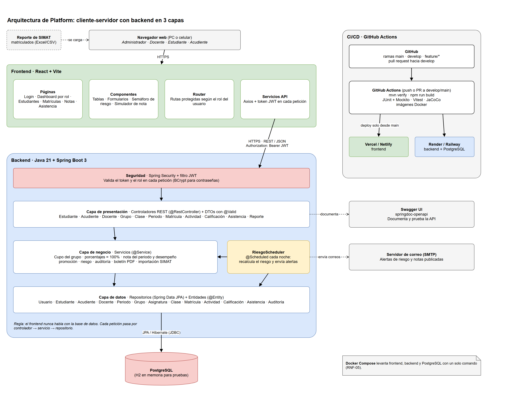

# Arquitectura del sistema



## 1. Estilo de arquitectura

Platform usa una arquitectura **cliente-servidor web**, y el servidor está organizado **en capas**.

- **Cliente-servidor.** El cliente es una aplicación React que corre en el navegador, así que no hay que instalar nada y funciona en PC y en celular. El servidor es una API REST en Spring Boot, y es la **única fuente de verdad**: todas las reglas de negocio y todos los datos viven allí.
- **Capas.** Dentro del servidor, el código se separa en presentación, negocio y datos. Cada capa solo llama a la que tiene debajo. Así, un cambio en la pantalla o en la base de datos no obliga a tocar las reglas de negocio, y cada capa se puede probar por separado (RNF-04).

**Regla principal:** el frontend nunca habla directo con la base de datos. Toda petición pasa por seguridad → controlador → servicio → repositorio.

### Por qué esta arquitectura

| Decisión | Alternativa descartada | Motivo |
|---|---|---|
| API REST + aplicación React separada | Páginas generadas por el servidor (Thymeleaf) | Frontend y backend se desarrollan y prueban por separado, y la misma API podría usarla después una aplicación móvil. |
| Monolito en capas | Microservicios | Para un proyecto de este tamaño, los microservicios agregan despliegues y comunicación entre servicios sin ningún beneficio real. |
| JWT sin estado | Sesiones en el servidor | El backend no guarda sesiones, así que es más simple desplegarlo y escalarlo. |
| PostgreSQL | Base de datos NoSQL | Los datos son muy relacionales (estudiante, matrícula, grupo, clase, nota) y necesitan restricciones de integridad (RNF-07). |

## 2. Componentes

### 2.1 Frontend: React + Vite

| Componente | Responsabilidad |
|---|---|
| Páginas | Una vista por pantalla: login, panel de cada rol, estudiantes, grupos, matrículas, notas, asistencia, boletines. |
| Componentes | Piezas reutilizables: tablas, formularios, el semáforo de riesgo, el simulador. |
| Router | Rutas protegidas: si el rol no tiene permiso, no deja entrar a la pantalla. |
| Servicios API | Funciones que llaman al backend con Axios y agregan el token JWT a cada petición. |

El frontend oculta lo que el usuario no puede hacer, pero **la seguridad real está en el backend**. Aunque alguien llame a la API saltándose la pantalla, el backend valida el rol de nuevo.

### 2.2 Backend: Java 21 + Spring Boot 3

| Capa | Componentes | Responsabilidad |
|---|---|---|
| Seguridad | Filtro JWT, configuración de Spring Security, BCrypt | Verifica el token y el rol **antes** de que la petición llegue al controlador. Cifra las contraseñas (RNF-01). |
| Presentación | `@RestController` y DTOs con `@Valid` | Recibe la petición HTTP, valida el formato de los datos y llama al servicio. No contiene reglas de negocio. |
| Negocio | `@Service` | Todas las reglas: cupo del grupo, porcentajes, nota del periodo y desempeño, promoción, riesgo, auditoría e importación de SIMAT. |
| Datos | Repositorios de Spring Data JPA y clases `@Entity` | Leen y escriben en la base de datos. Es la única capa que la toca. |

**Módulos de negocio.** Cada uno tiene su controlador, su servicio y su repositorio:

| Módulo | Casos de uso |
|---|---|
| Autenticación y usuarios | CU-01 |
| Estudiantes y acudientes | CU-02 |
| Docentes, asignaturas y grupos | CU-03 |
| Periodos y promoción | CU-04 |
| Matrículas e importación de SIMAT | CU-05 |
| Evaluación: actividades y calificaciones | CU-06, CU-07 |
| Asistencia | CU-08 |
| Consultas y simulador | CU-09 |
| Reportes | CU-10 |
| Riesgo: `RiesgoScheduler` con `@Scheduled` | CU-11 |

### 2.3 Base de datos

PostgreSQL en desarrollo y en producción, y H2 en memoria para las pruebas automáticas. Las tablas salen de las entidades del diagrama de clases. Las reglas de unicidad, como una sola nota por matrícula y actividad, se refuerzan también con restricciones `UNIQUE` en la base de datos.

### 2.4 Servicios externos

| Servicio | Uso |
|---|---|
| Servidor de correo (SMTP) | El planificador envía las alertas de riesgo. |
| Swagger UI (springdoc-openapi) | Documentación de la API, que se puede probar desde el navegador (RNF-06). |

## 3. Aspectos transversales

Son temas que afectan a todas las capas.

### 3.1 Seguridad
1. El usuario inicia sesión. El backend compara la contraseña con el hash BCrypt guardado y, si coincide, devuelve un **JWT** firmado que incluye el id y el rol, y que vence a las pocas horas.
2. El frontend envía ese token en cada petición, en el encabezado `Authorization: Bearer <token>`.
3. El filtro JWT valida la firma y la fecha de vencimiento. Luego, cada endpoint declara qué roles pueden usarlo.
4. Las reglas de "solo lo propio" (el docente con sus clases, el acudiente con sus estudiantes) se validan en el servicio, comparando con el usuario del token.

### 3.2 Manejo de errores
Un `@RestControllerAdvice` captura todas las excepciones y las convierte en una respuesta con el mismo formato:

```json
{ "estado": 400, "error": "Validación", "mensaje": "La nota debe estar entre 1.0 y 5.0", "fecha": "2026-11-20T10:15:00" }
```

| Situación | Código HTTP |
|---|---|
| Datos inválidos o regla de negocio incumplida | 400 |
| No inició sesión o el token es inválido | 401 |
| El rol no tiene permiso | 403 |
| El recurso no existe | 404 |
| Error inesperado (por ejemplo, la base de datos caída) | 500, con un mensaje genérico. El detalle técnico solo queda en el log. |

El frontend muestra el campo `mensaje` y nunca muestra la traza técnica (RNF-09).

### 3.3 Auditoría y logs
- **Auditoría (RF-09):** cada cambio de una nota se guarda en la tabla `auditoria`, con el registro modificado (`entidad` + `registroId`), el valor anterior, el valor nuevo, el usuario y la fecha. Es información del negocio y la puede consultar el Administrador.
- **Logs técnicos:** SLF4J + Logback registran los errores, los intentos fallidos de inicio de sesión y la ejecución del planificador. Sirven para diagnosticar problemas y no se muestran al usuario.

### 3.4 Copias de seguridad
En producción se hace una copia diaria de PostgreSQL, con `pg_dump` o con el respaldo automático del proveedor (RNF-09).

## 4. Estructura del código

```
backend/src/main/java/.../platform/
├── config/        # Seguridad, CORS, Swagger
├── security/      # Filtro JWT, generación y validación de tokens
├── controller/    # @RestController
├── dto/           # Objetos de entrada y salida de la API
├── service/       # Reglas de negocio
├── scheduler/     # RiesgoScheduler
├── repository/    # Spring Data JPA
├── entity/        # @Entity y enums
└── exception/     # Excepciones propias y @RestControllerAdvice

frontend/src/
├── pages/         # Pantallas
├── components/    # Componentes reutilizables
├── services/      # Llamadas a la API
├── routes/        # Rutas protegidas por rol
└── context/       # Sesión del usuario
```

## 5. Tecnologías

| Capa | Tecnología |
|---|---|
| Frontend | React, Vite, React Router, Axios |
| Backend | Java 21, Spring Boot 3 (Web, Data JPA, Validation, Security), Maven |
| Base de datos | PostgreSQL; H2 para pruebas |
| Seguridad | Spring Security, JWT, BCrypt |
| Pruebas | JUnit 5, Mockito, Spring Boot Test (MockMvc), Vitest, JaCoCo |
| Documentación de la API | springdoc-openapi (Swagger UI) |
| Contenedores | Docker, Docker Compose |
| CI/CD | GitHub Actions |

## 6. Despliegue y CI/CD

1. Cada push y cada pull request ejecutan **GitHub Actions**: compilan el backend (`mvn verify`), corren las pruebas con su cobertura, compilan el frontend (`npm run build`) y construyen las imágenes Docker.
2. Si algo falla, el pull request queda marcado en rojo y no se debe fusionar.
3. **Solo se despliega lo que está en `main`:** el frontend en Vercel o Netlify, y el backend y la base de datos en Render o Railway.
4. En local, `docker compose up` levanta el frontend, el backend y PostgreSQL juntos (RNF-05).

El detalle del flujo de ramas está en [02-flujo-desarrollo.md](02-flujo-desarrollo.md).
